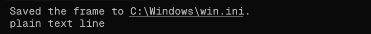

# pathclick

File paths in Windows Terminal work like links.



- Hover over a path and it gets an underline.
- **Ctrl+Click** opens the file in its default app. A folder opens in Explorer.
- **Ctrl+Shift+Click** shows the Windows "Open with" chooser.

Claude Code prints a lot of file paths: a screenshot it saved, a report, a log.
Windows Terminal only makes URLs clickable, so each of those paths means select,
copy, paste somewhere. pathclick removes that step. It reads the text under the
cursor, so it works for any path in the terminal, not only in Claude Code's output.

## Requirements

- Windows 10 or 11
- Windows Terminal
- [AutoHotkey v2](https://www.autohotkey.com/): `winget install AutoHotkey.AutoHotkey`

## Install

As a Claude Code plugin:

```
claude plugin marketplace add sa1ntsinner/pathclick
claude plugin install pathclick@pathclick
```

The plugin starts the script when a Claude Code session starts. The script keeps
running after the session ends and uses no noticeable CPU.

Without Claude Code: clone the repository and run `scripts\pathclick.ahk`. Put a
shortcut to it in `shell:startup` to have it start with Windows.

## What counts as a path

- Absolute paths: `C:\...`, `C:/...`, `~\...`.
- The file or folder must exist. That check is what separates a path from text
  that looks like one, and it lets paths with spaces work without quotes.
- A trailing `:12`, a full stop or a bracket after the path is ignored.
- A long path wrapped over two rows is still one path.

Relative paths such as `src/main.ts` are not handled: the script cannot know the
working directory of the program that printed them.

A click that is not on a path goes to the terminal as usual, so URLs and
Ctrl+drag selection keep working.

## Settings

Three values at the top of `scripts\pathclick.ahk`:

| Name | Meaning |
| --- | --- |
| `HOVER_MS` | How often the cursor is checked, in milliseconds |
| `FADE` | Opacity steps of the underline pulse; the last one stays |
| `LINE_PX` | Underline thickness in pixels; `0` derives it from the text height |

The underline is light on a dark terminal and dark on a light one.

## Stop or remove

End the `AutoHotkey64.exe` process that runs `pathclick.ahk` in Task Manager. To
remove the plugin: `claude plugin uninstall pathclick@pathclick`.

## Test

```
"C:\Program Files\AutoHotkey\v2\AutoHotkey64.exe" /ErrorStdOut tests\pathclick.test.ahk | more
```

The test opens a terminal window for a few seconds, prints paths into it and
reads them back the same way a hover does.

## License

MIT
