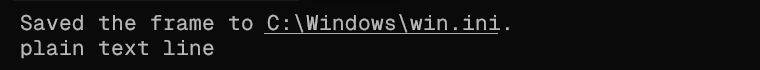

# Compatibility

## Terminals and agents

pathclick uses [OSC 8](https://gist.github.com/egmontkob/eb114294efbcd5adb1944c9f3cb5feda),
an existing terminal hyperlink protocol, with `file:` URLs. Link rendering, file
scheme policy and click modifiers are terminal settings, not agent capabilities.
OSC 8 support alone does not guarantee that a terminal allows local file URLs.
Try `pathclick link ./README.md --format osc8` directly in the terminal. If clicking
does not open it, use `pathclick open ./README.md` instead.

A skill teaches an agent to resolve and share file references; it does not patch
arbitrary terminal output. Agents can strip terminal escapes from tool results;
their final answer renderer may instead support Markdown absolute file links.
The skill explains both cases. Agents without Agent Skills support can run the CLI.

`--cwd` must name the project for that reference; absent it, the command's actual
working directory is used. There is no global "last project", so simultaneous
sessions cannot overwrite each other's resolution context. Relative references
are resolved by the helper, not by guessing a foreground terminal process's cwd.

For SSH, containers, WSL and remote workspaces the CLI opens on the executing
machine. Host and guest paths are not automatically mapped or downloaded. A remote
`file:` URI is not a portable download link. Windows paths are resolved on Windows,
POSIX paths on macOS/Linux; this is not a filesystem translation layer.

## CLI app choice

- Windows: PowerShell 5.1 and SHOpenWithDialog (does not change the default app).
  Directories open in Explorer even with `--choose`.
- macOS: `open` for the associated app, AppleScript Choose Application for choice.
  macOS may request Automation permission for the chosen app.
- Linux: `xdg-open` (normally provided by xdg-utils); `--choose` additionally needs
  Python 3, PyGObject and GTK 3. Debian/Ubuntu:
  `sudo apt install xdg-utils python3-gi gir1.2-gtk-3.0`.
- Chooser cancellation opens nothing. Missing apps, missing files and launch
  failures are reported. Headless sessions cannot display an app chooser.

`open` intentionally asks the OS to launch a local file; only open files you mean
to launch. It can execute programs if that is their associated OS action. Path
arguments are passed without a command shell. There is no custom URI handler or
network listener and no automatic opening while links are generated.

## Optional Windows Terminal helper

Install [AutoHotkey v2](https://www.autohotkey.com/):

```powershell
winget install AutoHotkey.AutoHotkey
```

The Claude plugin's SessionStart starts `scripts/pathclick.ahk`. Without the plugin,
clone the repository and run `powershell -NoProfile -File scripts/start.ps1`.
The helper works with output from any application in Windows Terminal:

- Hover: an underline with a short opacity pulse.
- Ctrl+Click: open the associated app, or Explorer for a directory.
- Ctrl+Shift+Click: Windows Open With.



The helper reads Windows Terminal text using UI Automation. It recognises existing
absolute `C:\...`, `C:/...` and `~\...` paths, including spaces, trailing location
suffixes, and paths wrapped across two rows. It cannot determine a pane's cwd, so
bare relative text uses the portable CLI/skill instead. It does not support other
Windows terminal hosts. Non-path clicks are passed through. Settings are at the
top of `scripts/pathclick.ahk`: `HOVER_MS`, `FADE`, `LINE_PX`.

The script stays running after Claude exits. Stop its AutoHotkey process in Task
Manager; removing the plugin prevents future starts. The standalone skill neither
starts nor installs AutoHotkey.

## Development

`npm test` runs real filesystem/CLI checks and tests native launcher arguments
without opening desktop apps. GitHub Actions runs these on Windows, macOS and
Linux; native chooser interaction and terminal gestures need desktop checks.
The existing Windows UI Automation test opens a temporary terminal window:

```powershell
& 'C:\Program Files\AutoHotkey\v2\AutoHotkey64.exe' /ErrorStdOut tests/pathclick.test.ahk
```
